<<<<<<< HEAD
# TechNova - Infraestrutura AWS com Terraform

## Aluno

* **Nome:** Renan Dias
* **RA:** 6325033
* **Data:** 15/09/2026

---

## Sobre o projeto

Este projeto apresenta a criação de uma infraestrutura na AWS utilizando **Terraform**, com foco em conceitos de redes, alta disponibilidade entre Availability Zones, Security Groups e provisionamento de uma instância EC2 utilizando User Data.

A infraestrutura foi desenvolvida no ambiente **AWS Academy Learner Lab**.

---

## Arquitetura

A infraestrutura utiliza uma VPC com CIDR `10.0.0.0/16`, distribuída em duas Availability Zones.

Cada Availability Zone possui uma subnet pública e uma subnet privada.

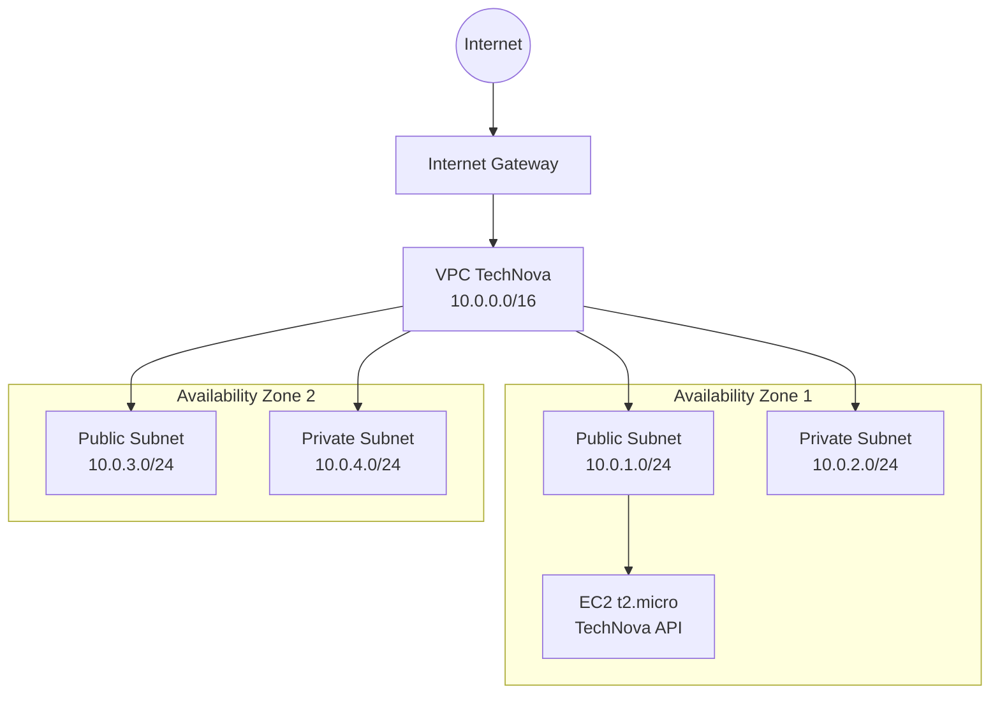

### Componentes da arquitetura

* 1 VPC: `10.0.0.0/16`
* 2 subnets públicas
* 2 subnets privadas
* 2 Availability Zones
* 1 Internet Gateway
* 1 tabela de rotas pública
* Subnets privadas utilizando a tabela de rotas padrão
* 1 Security Group para a API
* 1 Security Group reservado para o banco de dados
* 1 instância EC2 `t2.micro`
* API Node.js/Express executando na porta `3000`

---

## Estrutura do projeto

```text
aula-04/
├── .gitignore
├── providers.tf
├── main.tf
├── variables.tf
├── outputs.tf
├── key_pair.tf
├── user_data.sh
├── evidencia-plan.txt
├── terraform-plan-output.txt
├── evidencia-api.json
├── evidencia-ssh.txt
├── .terraform.lock.hcl
└── README.md
```

=======
# Aula 04 — VPC, Networking e EC2 na AWS

## Objetivos de Aprendizagem

Ao final desta aula, o aluno será capaz de:

1. Compreender o conceito de VPC e sua importância para isolamento de rede
2. Diferenciar subnets públicas e privadas e seus casos de uso
3. Configurar Internet Gateway e Route Tables para acesso à internet
4. Provisionar uma VPC completa com subnets usando Terraform
5. Compreender os conceitos fundamentais do EC2 (AMIs, instance types, key pairs, security groups)
6. Provisionar uma instância EC2 t2.micro dentro de uma VPC customizada
7. Configurar security groups para controle de tráfego e user data para automação
8. Conectar-se via SSH e verificar a API rodando na nuvem

---

## Contexto Narrativo

> **O Resgate da TechNova — Episódio 4: "Da Rede Segura ao Servidor na Nuvem"**

Na aula anterior, a equipe da TechNova deu seus primeiros passos na AWS: criou buckets S3 com Terraform e implementou IAM para eliminar o uso de credenciais root. A infraestrutura como código está funcionando, e cada membro da equipe tem seu próprio usuário com permissões mínimas.

Mas na reunião semanal, a consultora de segurança trouxe um alerta:

> "Vocês estão usando a **VPC padrão** da AWS. Isso significa que todos os recursos estão na mesma rede, expostos à internet por padrão. Se amanhã colocarem um banco de dados ali, ele estará acessível ao mundo inteiro. Precisamos de **isolamento de rede** — uma VPC customizada com subnets públicas e privadas."

O CTO Carlos Mendes completou:

> "Além da segurança, os investidores querem ver a API rodando em um **servidor real na nuvem** — não basta estar no laptop de alguém. Precisam de uma URL acessível externamente. Quando posso mostrar isso?"

A líder de Platform Engineering conectou os pontos:

> "Primeiro construímos a rede: uma VPC customizada com subnet pública para o servidor web e subnet privada para o banco de dados no futuro. Depois colocamos um **EC2** dentro dessa rede com a API rodando. É como construir a casa: primeiro você faz a fundação e o terreno (VPC), depois ergue as paredes e coloca os móveis (EC2 com a aplicação)."

Esse é o desafio desta aula: construir a infraestrutura de rede da TechNova do zero (VPC, subnets, Internet Gateway, Route Tables, Security Groups) e depois provisionar um servidor EC2 dentro dessa rede com a API acessível ao mundo.

---

## Cronograma da Aula

| Bloco | Atividade |
|:-----:|-----------|
| 1 | Revisão TA + Discussão em Grupo |
| 2 | Conteúdo Teórico — VPC e Networking |
| 3 | Laboratório Parte 1 — VPC com Terraform |
| 4 | Conteúdo Teórico — EC2 Instances |
| 5 | Laboratório Parte 2 — EC2 na VPC |
| 6 | Encerramento + Orientação TF |

---

## Conteúdo Original Consolidado

Esta aula consolida o conteúdo das aulas originais **Aula 06 (EC2 Instances)** e **Aula 07 (VPC e Networking)** em uma única aula. A ordem foi invertida intencionalmente: ensinamos **VPC primeiro** (construir a rede) e **EC2 depois** (colocar o servidor na rede), pois faz mais sentido pedagógico construir o "terreno" antes de colocar a "casa".

---

## Entrega do Trabalho em Aula

O trabalho em aula vale **1 ponto na nota final** do semestre (contabilizado apenas ao final, com todos os trabalhos entregues).

### Onde entregar

Na **mesma pasta** da entrega do TF, no fork da disciplina:

```
entregas/aula-04/SEU-RA/trabalho-em-aula.md
```

### O que entregar

Um arquivo `trabalho-em-aula.md` com as respostas das atividades realizadas em sala (discussões, diagramas, classificações).

### Observações

- A entrega é **individual** — mesmo que a atividade tenha sido em grupo
- O arquivo pode ser adicionado no **mesmo PR** do TF ou em PR separado
- Entregas parciais (apenas algumas aulas) **não garantem o ponto**

---

## Entrega do Trabalho de Fixação (TF)

O TF desta aula deve ser desenvolvido no **seu repositório pessoal** (`unifaat-devops-portfolio`, pasta `aula-04/`). A entrega neste repositório da disciplina consiste em um **arquivo Markdown (`entrega.md`)** contendo o **link para o seu repositório** e as evidências solicitadas.

### Passo a Passo

1. **Desenvolva o TF** no seu repositório pessoal (`unifaat-devops-portfolio/aula-04/`)
2. Faça **fork** do repositório da disciplina (se ainda não fez)
3. Crie uma **branch**: `SEU-RA/tf-04`
4. Crie a pasta `entregas/aula-04/SEU-RA/`
5. Adicione o arquivo **`entrega.md`** com o link do seu repositório + evidências
6. Faça commits descritivos seguindo [Conventional Commits](https://www.conventionalcommits.org/pt-br/)
7. Abra um **Pull Request** para o repositório original com título: `[Aula 04] RA: XXXXX - Nome Completo`

### Modelo do arquivo `entrega.md`

```markdown
# Entrega — Aula 04: VPC + EC2 Multi-AZ

**Aluno:** [Seu nome completo]  
**RA:** [Seu RA]  
**Data:** [Data da entrega]

## Repositório

- URL: https://github.com/SEU-USUARIO/unifaat-devops-portfolio

## Evidências

- [ ] VPC com 4 subnets (2 públicas + 2 privadas) em 2 AZs
- [ ] Internet Gateway + Route Tables configurados
- [ ] Security Groups com menor privilégio
- [ ] EC2 t2.micro com User Data (API rodando)
- [ ] Instance Profile com IAM Role
- [ ] Tags em todos os recursos
- [ ] `terraform-plan-output.txt` com evidência do plano
- [ ] README com diagrama da arquitetura
- [ ] `terraform destroy` executado após evidências

## Evidência da API Rodando

[Cole aqui o output do curl ou screenshot]
```

> **Importante:** O repositório pessoal do aluno deve estar **público** para que o professor consiga avaliar. PRs que não contenham o link para o repositório ou cujo repositório esteja privado serão considerados **incompletos**.

Para detalhes completos sobre os entregáveis e critérios de avaliação, consulte o arquivo [`TF.md`](TF.md).

>>>>>>> aa8a051c3f8bc8b41cbf478447ac9d9ff5af106d
---

## Pré-requisitos

<<<<<<< HEAD
Para executar o projeto, são necessários:

* AWS CLI configurado com as credenciais do AWS Academy Learner Lab
* Terraform instalado
* Acesso ao AWS Academy Learner Lab
* Chave SSH `technova-key`
* Git instalado para versionamento do projeto

---

## Configuração

As principais variáveis utilizadas pelo projeto estão no arquivo `terraform.tfvars`:

```hcl
aws_region = "us-east-1"
owner      = "6325033"
```

A região utilizada no ambiente foi `us-east-1`.

---

## Como executar

Entre na pasta do Terraform:

```bash
cd aula-04/terraform
```

Inicialize o Terraform:

```bash
terraform init
```

Verifique a configuração:

```bash
terraform validate
```

Visualize o plano de execução:

```bash
terraform plan
```

Para criar a infraestrutura:

```bash
terraform apply
```

Quando solicitado, confirme digitando:

```text
yes
```

---

## Outputs

Após a aplicação da infraestrutura, os principais dados podem ser consultados com:

```bash
terraform output
```

Outputs disponibilizados:

* `vpc_id`
* `public_subnet_ids`
* `private_subnet_ids`
* `api_security_group_id`
* `db_security_group_id`
* `ec2_public_ip`
* `api_url`
* `ssh_command`

---

## Security Groups

### Security Group da API

O Security Group da API permite:

| Protocolo | Porta | Origem      |
| --------- | ----: | ----------- |
| TCP       |    22 | `0.0.0.0/0` |
| TCP       |  3000 | `0.0.0.0/0` |

O tráfego de saída é permitido.

### Security Group do banco de dados

Foi criado um Security Group preparado para um futuro banco PostgreSQL.

| Protocolo | Porta | Origem        |
| --------- | ----: | ------------- |
| TCP       |  5432 | `10.0.0.0/16` |

O tráfego de saída é permitido.

---

## EC2 e User Data

A instância EC2 utiliza:

* Tipo: `t2.micro`
* Amazon Linux 2023
* Subnet pública
* Security Group da API
* Key Pair `technova-key`
* Instance Profile existente `LabInstanceProfile`

O arquivo `user_data.sh` é executado automaticamente durante a inicialização da instância.

Ele realiza as seguintes tarefas:

1. Atualiza o sistema.
2. Instala Node.js 18.
3. Instala o npm.
4. Cria a aplicação da TechNova.
5. Instala o Express.
6. Cria os endpoints da API.
7. Inicia a aplicação na porta `3000`.

---

## Endpoints da API

A API possui três endpoints:

### `/`

Retorna o status da aplicação:

```json
{
  "status": "ok",
  "app": "technova-api",
  "message": "API no ar!"
}
```

### `/health`

Endpoint utilizado para verificar a saúde da aplicação:

```json
{
  "status": "healthy",
  "service": "technova-api"
}
```

### `/orders`

Retorna uma lista de pedidos:

```json
[
  {
    "id": 1,
    "customer": "Cliente 1",
    "total": 150
  },
  {
    "id": 2,
    "customer": "Cliente 2",
    "total": 250
  }
]
```

---

## Testando a API

Após a criação da infraestrutura, a API pode ser acessada pelo IP público da EC2.

URL atual:

```text
http://44.204.141.114:3000
```

Teste do endpoint principal:

```bash
curl http://44.204.141.114:3000
```

Teste de saúde:

```bash
curl http://44.204.141.114:3000/health
```

Teste de pedidos:

```bash
curl http://44.204.141.114:3000/orders
```

Os três endpoints foram testados e responderam corretamente.

---

## Acesso SSH

O acesso à EC2 pode ser realizado utilizando:

```bash
ssh -i ~/.ssh/technova-key ec2-user@44.204.141.114
```

Também foi realizada uma verificação através do comando:

```bash
ssh -i ~/.ssh/technova-key ec2-user@44.204.141.114 "node --version && aws sts get-caller-identity"
```

Essa verificação foi registrada no arquivo:

```text
evidencia-ssh.txt
```

---

## Evidências

As evidências geradas durante a execução do projeto são:

### Terraform Plan

```text
evidencia-plan.txt
```

Contém a saída do comando:

```bash
terraform plan
```

### API

```text
evidencia-api.json
```

Contém as respostas dos endpoints:

```text
/
 /health
```

### SSH

```text
evidencia-ssh.txt
```

Contém a saída da verificação realizada através do acesso SSH à EC2.

---

## Decisões técnicas

### Terraform

O Terraform foi utilizado para permitir que toda a infraestrutura fosse definida como código e pudesse ser criada e destruída de maneira controlada.

### Multi-AZ

A VPC foi distribuída em duas Availability Zones, com uma subnet pública e uma subnet privada em cada AZ.

Essa organização permite que a arquitetura seja expandida futuramente para componentes de alta disponibilidade.

### Subnets públicas e privadas

As subnets públicas possuem associação com a tabela de rotas que utiliza o Internet Gateway.

As subnets privadas não possuem rota direta para a internet.

### EC2

Foi utilizada uma instância `t2.micro`, conforme especificado para o laboratório.

### User Data

O User Data foi utilizado para automatizar a configuração inicial da EC2 e executar a API sem necessidade de configuração manual dentro da instância.

### API

Para simplificar o laboratório, a aplicação foi criada diretamente pelo User Data utilizando Node.js e Express.

### IAM

No ambiente AWS Academy Learner Lab foi utilizado o Instance Profile existente:

```text
LabInstanceProfile
```

Não foi criado um novo IAM Role ou Instance Profile pelo Terraform.

---

## Recursos criados

| Recurso                 | Quantidade |
| ----------------------- | ---------: |
| VPC                     |          1 |
| Subnets públicas        |          2 |
| Subnets privadas        |          2 |
| Internet Gateway        |          1 |
| Route Table pública     |          1 |
| Security Group da API   |          1 |
| Security Group do banco |          1 |
| EC2                     |          1 |
| Key Pair                |          1 |

---

## Tags

Os recursos foram configurados com tags para facilitar a identificação e organização da infraestrutura.

Padrão utilizado:

```text
Name
Project = TechNova
Environment = development
ManagedBy = Terraform
Owner = 6325033
```

---

## Destruir a infraestrutura

Depois de concluir os testes e coletar as evidências, a infraestrutura pode ser removida com:

```bash
terraform destroy
```

Confirme a operação digitando:

```text
yes
```

O comando remove os recursos gerenciados pelo Terraform.

---

## Conclusão

O projeto demonstra a criação de uma infraestrutura AWS utilizando Terraform, incluindo VPC, subnets públicas e privadas distribuídas em duas Availability Zones, Internet Gateway, tabelas de rotas, Security Groups e uma instância EC2.

A EC2 foi configurada automaticamente através de User Data para executar uma API Node.js/Express.

A infraestrutura e a API foram testadas durante a execução do laboratório, e as evidências foram registradas nos arquivos disponibilizados no projeto.
=======
- **Conta AWS** criada com Free Tier ativo — [Criar conta AWS](https://aws.amazon.com/free/)
- **Terraform** instalado (≥ 1.0) — [Download](https://developer.hashicorp.com/terraform/downloads)
- **AWS CLI** instalado e configurado — [Guia](https://docs.aws.amazon.com/cli/latest/userguide/getting-started-install.html)
- **Docker e Docker Compose** funcionando (Aulas 01-02)
- **Git** instalado e configurado (Aulas 01-02)
- **Conhecimentos da Aula 03:** Terraform (init/plan/apply/destroy), HCL, IAM (users, groups, roles, policies)
- Editor de texto (VS Code com extensão HashiCorp Terraform recomendada)
- **Cliente SSH** (terminal Linux/Mac ou PuTTY no Windows)

> **⚠️ Free Tier:** Todos os recursos criados nesta aula são elegíveis ao AWS Free Tier. VPC é gratuita (apenas NAT Gateway cobra). EC2 t2.micro = 750 horas/mês grátis nos primeiros 12 meses. Lembre-se de executar `terraform destroy` ao final do Laboratório Parte 2.

---

## Conteúdo Teórico — Parte 1: VPC e Networking

### 1. O Problema: VPC Padrão Não Oferece Isolamento

Quando você cria uma conta AWS, ela vem com uma **VPC padrão** (Default VPC) em cada região. Ela funciona, mas tem problemas sérios para produção:

| Aspecto | VPC Padrão | VPC Customizada |
|---------|------------|-----------------|
| Isolamento | Todos os recursos na mesma rede | Segmentação por subnets |
| Exposição | Subnets públicas por padrão | Você escolhe o que é público |
| CIDR | Fixo (172.31.0.0/16) | Você define o bloco de IPs |
| Banco de dados | Exposto à internet | Subnet privada, sem acesso externo |
| Controle | Limitado | Total sobre roteamento e firewalls |

**Cenário real da TechNova:**
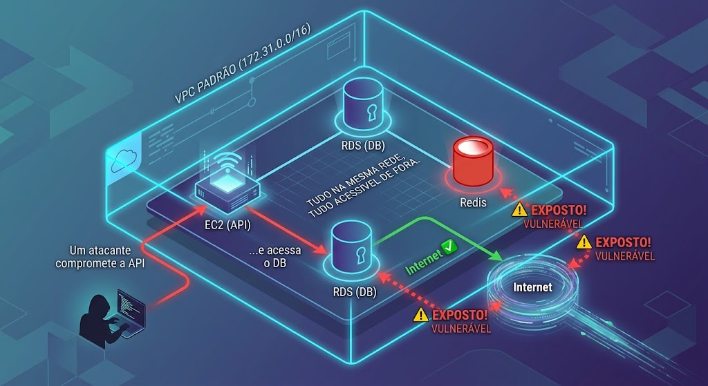
### 2. O que é uma VPC?

Uma **VPC** (Virtual Private Cloud) é sua rede privada isolada dentro da AWS. Pense como um "data center virtual":

- Você define o **espaço de endereços IP** (CIDR block)
- Dentro dela, cria **subnets** (sub-redes) em diferentes Availability Zones
- Controla **quem entra e quem sai** com Security Groups e NACLs
- Define **rotas** para o tráfego (Route Tables)

**Analogia:** VPC é como um condomínio fechado. Você decide quantos prédios (subnets) construir, quais têm acesso à rua (públicas) e quais ficam isolados internamente (privadas). O porteiro (Security Group) controla quem entra em cada prédio.

### 3. CIDR Notation — Entendendo Blocos de IP

**CIDR** (Classless Inter-Domain Routing) define um intervalo de endereços IP:

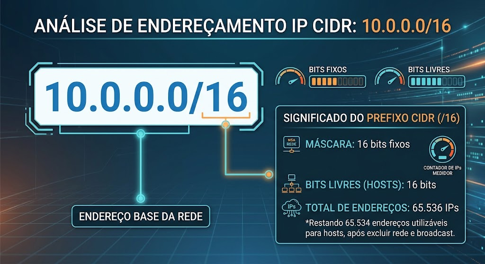

**Exemplos práticos:**

| CIDR | IPs Disponíveis | Uso Típico |
|------|----------------|------------|
| `10.0.0.0/16` | 65.536 | VPC inteira |
| `10.0.1.0/24` | 256 | Uma subnet |
| `10.0.2.0/24` | 256 | Outra subnet |
| `192.168.0.0/24` | 256 | Rede doméstica |

**Como funciona a máscara:**
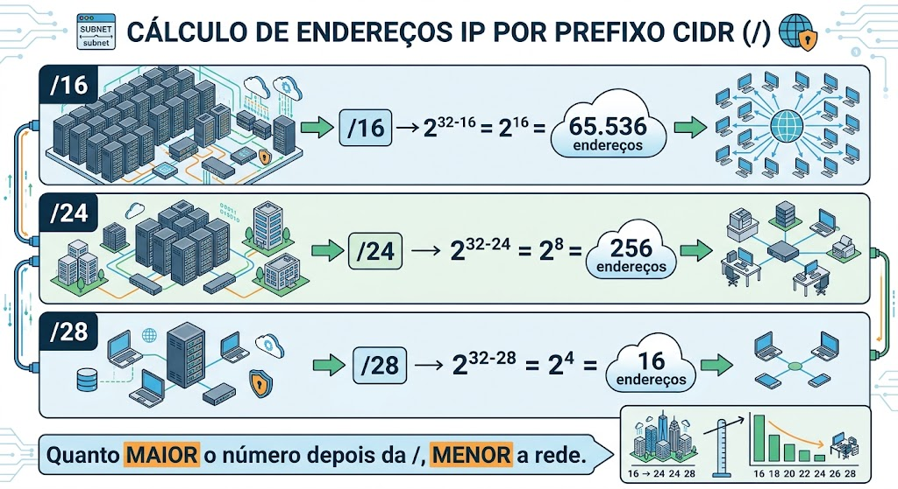

**Design da rede TechNova:**
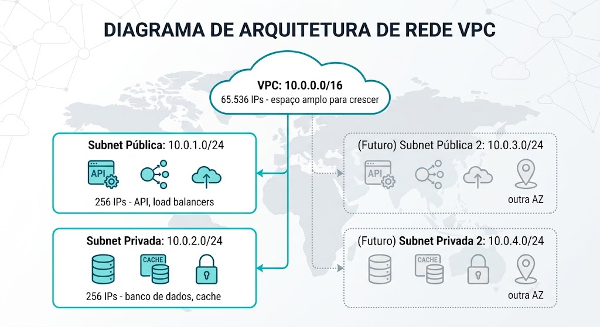

### 4. Subnets: Pública vs Privada

Uma **subnet** é uma subdivisão da VPC em um bloco menor de IPs, localizada em uma Availability Zone específica:

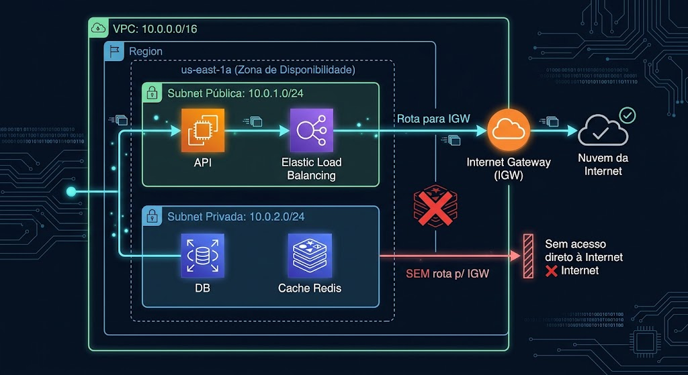

**O que torna uma subnet "pública"?**
- Ter uma rota na Route Table apontando para o Internet Gateway
- Instâncias nela podem receber IP público

**O que torna uma subnet "privada"?**
- NÃO ter rota para o Internet Gateway
- Instâncias nela só são acessíveis internamente (dentro da VPC)

### 5. Internet Gateway (IGW)

O **Internet Gateway** é o componente que conecta sua VPC à internet:
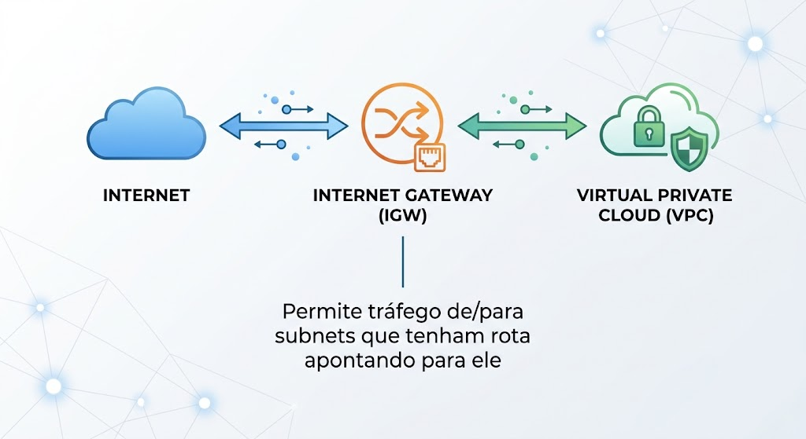
- Uma VPC pode ter **apenas um** IGW
- É **gratuito** — sem custos adicionais
- Sem IGW, nada dentro da VPC acessa a internet

### 6. Route Tables (Tabelas de Rotas)

Uma **Route Table** contém regras que determinam para onde o tráfego de rede é direcionado:

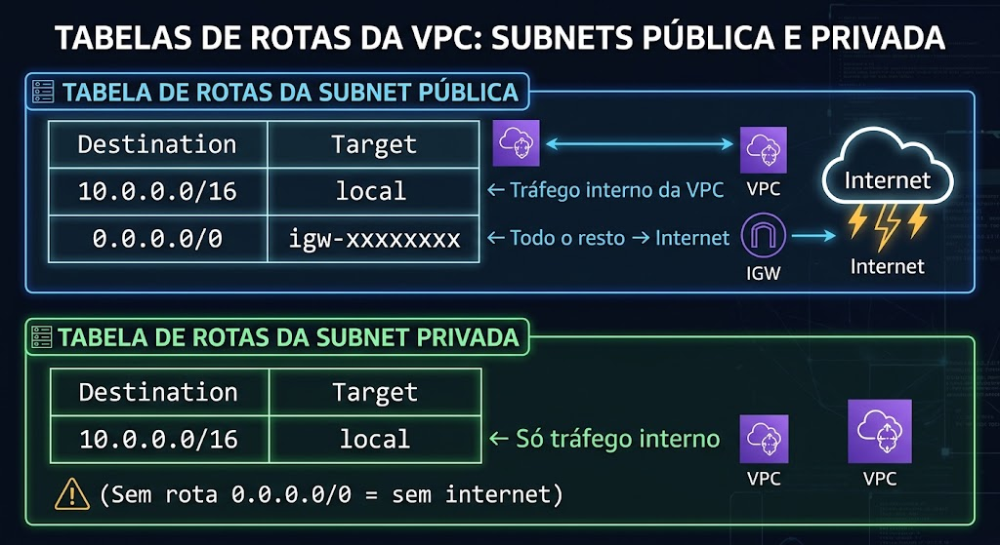

### 7. NAT Gateway (Conceito)

E se um recurso na subnet privada precisar **acessar** a internet (ex: baixar atualizações), mas **não pode ser acessado** de fora?

A solução é o **NAT Gateway**:
- Fica na subnet **pública**
- A subnet privada tem uma rota apontando para ele
- Permite tráfego **de saída** (outbound), mas bloqueia entrada (inbound)

> **⚠️ Custo:** NAT Gateway custa ~$0.045/hora (~$32/mês). **NÃO usaremos neste lab.** É importante conhecer o conceito, mas só implementaremos em aulas futuras.

### 8. Security Groups vs NACLs

Ambos são firewalls, mas com diferenças fundamentais:

| Característica | Security Group | NACL |
|----------------|---------------|------|
| Nível | Instância (ENI) | Subnet |
| Stateful/Stateless | **Stateful** | Stateless |
| Regras | Apenas ALLOW | ALLOW e DENY |
| Avaliação | Todas as regras | Por ordem numérica |
| Default | Nega tudo (inbound) | Permite tudo |

**Stateful vs Stateless:**
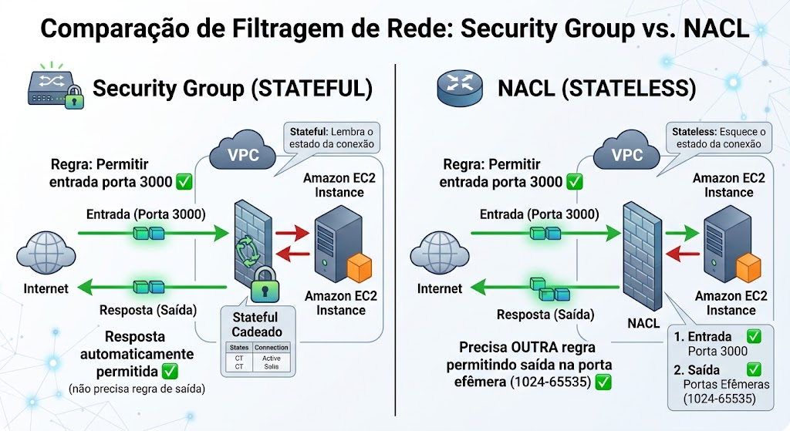

> **Neste curso:** Usaremos principalmente **Security Groups** por serem mais simples e suficientes para nosso cenário. NACLs são mencionadas para conhecimento.

### 9. VPC é GRATUITA!

Componentes **sem custo:**
- VPC (ilimitadas por conta)
- Subnets
- Internet Gateway
- Route Tables
- Security Groups
- NACLs

Componentes **com custo:**
- NAT Gateway (~$32/mês)
- VPN Gateway
- Elastic IPs não associados
- Tráfego entre AZs (mínimo)

---

## Conteúdo Teórico — Parte 2: EC2 Instances

### 1. O que é EC2?

**EC2** (Elastic Compute Cloud) são servidores virtuais sob demanda na AWS. Você escolhe o sistema operacional, a capacidade de hardware, e a rede — e a AWS provisiona a máquina em segundos:
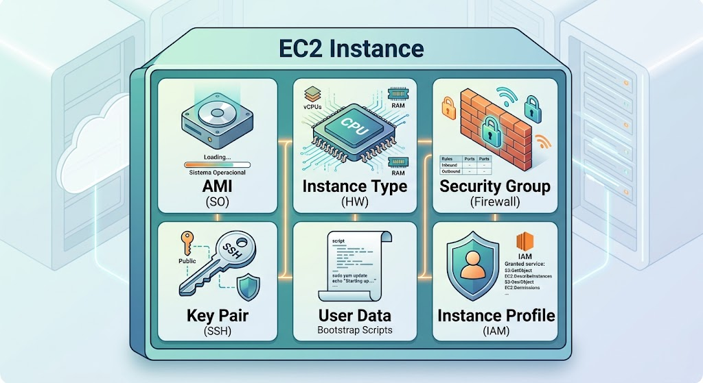

### 2. AMI — Amazon Machine Image

Uma **AMI** é um template pré-configurado com o sistema operacional e software base:

| AMI | Sistema | Uso |
|-----|---------|-----|
| Amazon Linux 2023 | Linux (Red Hat-based) | **Recomendada** — otimizada para AWS |
| Ubuntu 22.04 LTS | Linux (Debian-based) | Popular, boa documentação |
| Windows Server 2022 | Windows | Aplicações .NET |

**Por que Amazon Linux 2023?**
- Otimizada para performance na AWS
- AWS CLI já instalada
- Suporte a longo prazo
- Sem custo adicional de licença

> **Nota:** Cada AMI tem um ID diferente por região. Usaremos um **data source** no Terraform para buscar a AMI mais recente automaticamente.

### 3. Instance Types — Tipos de Instância

O **instance type** define o hardware virtual (CPU, memória, rede):
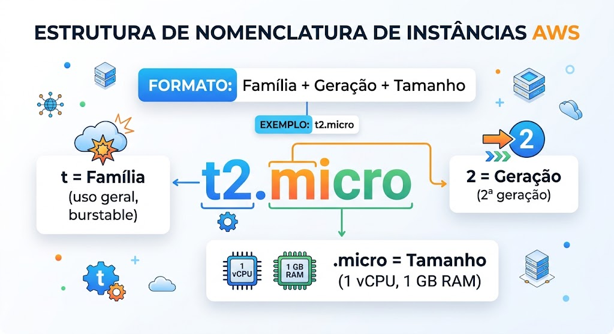

**Tipos comuns:**

| Type | vCPU | RAM | Uso | Free Tier |
|------|------|-----|-----|-----------|
| `t2.micro` | 1 | 1 GB | Testes, labs | ✅ 750h/mês |
| `t2.small` | 1 | 2 GB | Aplicações leves | ❌ |
| `t3.medium` | 2 | 4 GB | Aplicações médias | ❌ |
| `m5.large` | 2 | 8 GB | Produção | ❌ |

> **⚠️ IMPORTANTE:** Usaremos **sempre `t2.micro`** neste curso para manter tudo no Free Tier.

### 4. Key Pairs — Acesso SSH

Um **key pair** é um par de chaves criptográficas para acesso SSH seguro:

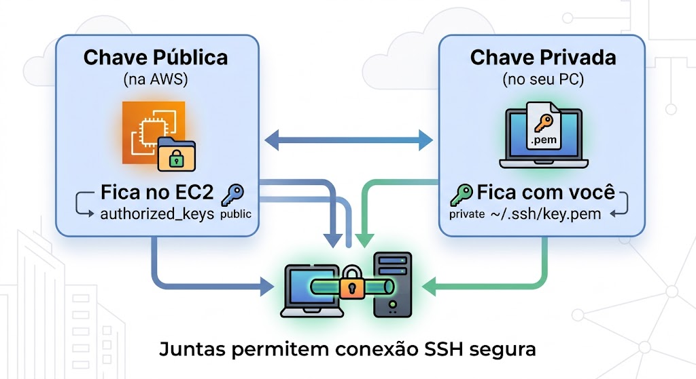

**Regras importantes:**
- A chave privada é baixada **uma única vez** — se perder, precisa criar outra
- Permissões do arquivo: `chmod 400 key.pem` (somente leitura para o dono)
- **Nunca versione chaves privadas no Git!**

### 5. Security Groups — Firewall Virtual

Security Groups controlam o tráfego de rede **para** e **da** instância EC2:

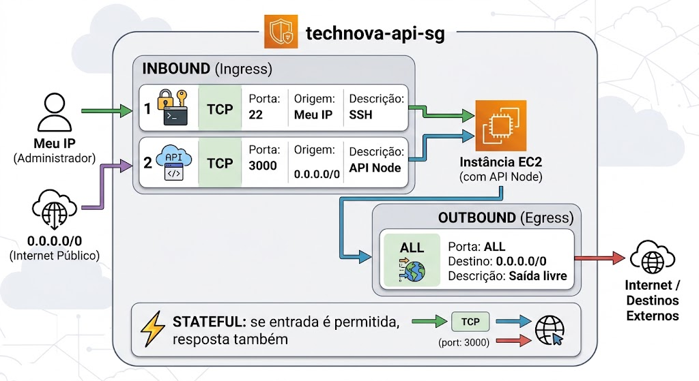

### 6. User Data — Automação no Boot

**User Data** é um script que executa automaticamente quando a instância EC2 inicia pela primeira vez:

```bash
#!/bin/bash
# User Data - executa como root no primeiro boot

# Atualizar sistema
yum update -y

# Instalar Node.js
curl -fsSL https://rpm.nodesource.com/setup_18.x | bash -
yum install -y nodejs git

# Clonar e iniciar a aplicação
cd /home/ec2-user
git clone https://github.com/seu-repo/technova-api.git
cd technova-api
npm install
npm start &
```

**Pontos importantes:**
- Executa como **root** (`#!/bin/bash`)
- Roda apenas no **primeiro boot** (não em reboots)
- Logs em `/var/log/cloud-init-output.log`
- Se falhar, a instância sobe mas a aplicação não funciona

### 7. Instance Profile — Conectando IAM ao EC2

Na Aula 03, aprendemos sobre IAM Roles. O **Instance Profile** é como "vestimos" uma Role em um EC2:

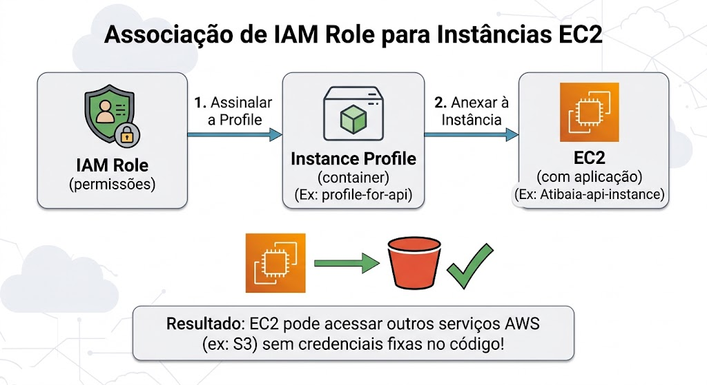

### 8. Free Tier EC2

| Recurso | Limite Gratuito | Período |
|---------|----------------|---------|
| EC2 t2.micro | 750 horas/mês | 12 meses |
| EBS (disco) | 30 GB SSD gp2 | 12 meses |
| Transferência | 100 GB/mês saída | 12 meses |

> **⚠️ 750 horas = ~31 dias. Uma instância 24/7 inteiro mês = ~720h. Cabe no Free Tier!**
>
> Mas nós vamos **sempre destruir** com `terraform destroy` após os labs para evitar surpresas.

---

## Resumo dos Conceitos

| Conceito | Descrição |
|----------|-----------|
| VPC | Rede virtual privada isolada na AWS |
| CIDR | Notação para definir blocos de endereços IP |
| Subnet Pública | Subnet com rota para Internet Gateway |
| Subnet Privada | Subnet sem acesso direto à internet |
| Internet Gateway | Componente que conecta VPC à internet |
| Route Table | Regras de direcionamento de tráfego |
| NAT Gateway | Permite saída (mas não entrada) da subnet privada |
| Security Group | Firewall stateful no nível da instância |
| NACL | Firewall stateless no nível da subnet |
| EC2 | Servidores virtuais sob demanda |
| AMI | Template com SO pré-configurado |
| Instance Type | Hardware virtual (CPU/RAM) |
| Key Pair | Chaves para acesso SSH |
| User Data | Script de automação no primeiro boot |
| Instance Profile | Conecta IAM Role ao EC2 |

---

## 💰 Free Tier — Resumo de Custos

| Componente | Custo |
|------------|-------|
| VPC, Subnets, IGW, Route Tables | **Gratuito** (sempre) |
| Security Groups, NACLs | **Gratuito** (sempre) |
| EC2 t2.micro | **Gratuito** (750h/mês, 12 meses) |
| EBS 30 GB gp2 | **Gratuito** (12 meses) |
| Elastic IP (associado) | **Gratuito** |
| NAT Gateway | ⚠️ ~$32/mês (**NÃO usar no lab**) |

> **⚠️ Sempre execute `terraform destroy` após o Laboratório Parte 2 para evitar custos.**

---

*Próximas etapas: Laboratório Parte 1 (VPC com Terraform) → Laboratório Parte 2 (EC2 na VPC) → TF (Trabalho de Fixação)*
>>>>>>> aa8a051c3f8bc8b41cbf478447ac9d9ff5af106d
