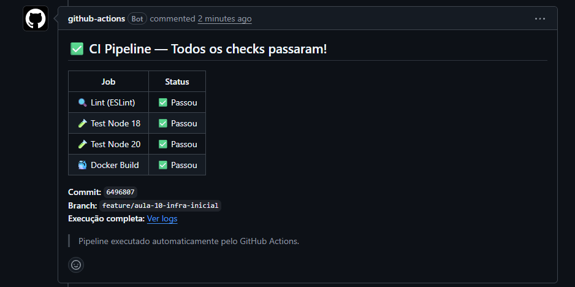
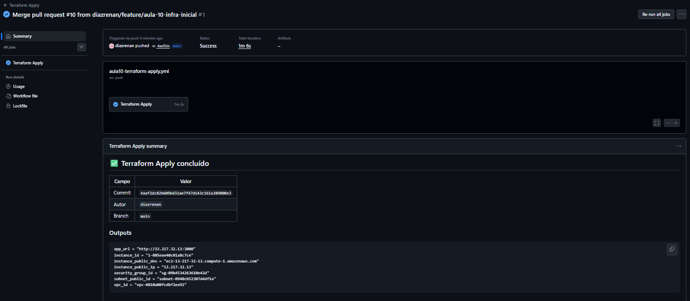
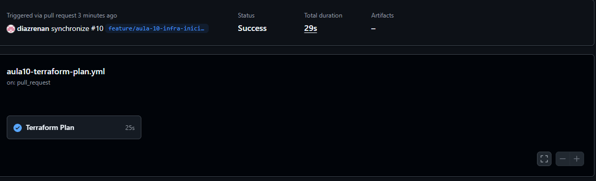

# GitOps + CD Pipeline — Análise Técnica

**Projeto:** TechNova — Aula 10  
**Aluno:** _(seu nome)_  
**Data:** Novembro/2026  
**Ambiente:** AWS Academy Learner Lab · us-east-1

---

## Sumário

1. [Fluxo GitOps: Plan no PR, Apply no Merge](#1-fluxo-gitops)
2. [Autenticação no Learner Lab vs OIDC em Produção](#2-autenticação)
3. [Estratégia de Deploy: Recreate](#3-estratégia-recreate)
4. [Continuous Delivery vs Continuous Deployment](#4-delivery-vs-deployment)
5. [Procedimento de Rollback](#5-rollback)
6. [Limitações e Melhorias](#6-limitações-e-melhorias)
7. [Screenshots de Evidência](#7-screenshots)

---

## 1. Fluxo GitOps

### O que é GitOps?

GitOps é um modelo operacional onde o **Git é a única fonte de verdade** para infraestrutura e aplicações. Qualquer mudança no ambiente passa obrigatoriamente por um commit — nunca por acesso direto ao console ou terminal.

O CTO da TechNova resumiu bem: *"A partir de hoje, nenhum humano executa Terraform diretamente e nenhum deploy é manual."* Isso é GitOps na prática.

### Por que Plan no PR?

Quando um desenvolvedor abre um Pull Request alterando arquivos `.tf`, o `terraform-plan.yml` executa automaticamente e **posta o resultado como comentário no PR**. Isso serve para:

- **Revisão antes da mudança:** toda a equipe vê exatamente o que vai ser criado, alterado ou destruído na AWS antes de qualquer coisa acontecer
- **Proteção contra surpresas:** um `terraform destroy` acidental fica visível no comentário e pode ser bloqueado pelo revisor
- **Auditoria:** o histórico do PR registra quem aprovou qual mudança de infraestrutura e quando
- **Gate de qualidade:** se o `plan` falhar (erro de sintaxe, credencial inválida, recurso inexistente), o PR fica **bloqueado para merge** via Branch Protection Rule — ninguém consegue fazer merge de infraestrutura quebrada

```
feature/nova-vpc  →  PR aberto  →  terraform-plan.yml dispara
                                    ├── terraform init
                                    ├── terraform validate
                                    ├── terraform plan
                                    └── Comentário no PR com o diff
                                         ├── Plan OK  → PR pode ser mergeado
                                         └── Plan falhou → PR BLOQUEADO
```

### Por que Apply no Merge?

O `terraform-apply.yml` dispara **somente quando o PR é aceito e mergeado na `main`**. Isso garante que:

- O apply só roda em código que **foi revisado e aprovado** pela equipe
- A branch `main` representa sempre o estado real da infraestrutura
- Não há drift entre o que está no Git e o que existe na AWS

```
merge para main  →  terraform-apply.yml dispara
                     ├── terraform init  (mesmo estado remoto do plan)
                     ├── terraform apply -auto-approve
                     └── Outputs registrados no log
                          └── IP da EC2 disponível para o job de deploy
```

### O ciclo completo

```
┌─────────────────────────────────────────────────────────┐
│                    FLUXO GITOPS                          │
│                                                         │
│  Desenvolvedor                                          │
│      │                                                  │
│      ▼                                                  │
│  git push → feature/branch                              │
│      │                                                  │
│      ▼                                                  │
│  Abre Pull Request → main                               │
│      │                                                  │
│      ▼                                                  │
│  terraform-plan.yml (automático)                        │
│      ├── Plan OK    → Comentário ✅ → Revisão humana    │
│      └── Plan falha → Comentário ❌ → PR BLOQUEADO      │
│                                │                        │
│                         Aprovação do time               │
│                                │                        │
│                         Merge para main                 │
│                                │                        │
│                                ▼                        │
│                   terraform-apply.yml (automático)      │
│                       └── Infraestrutura atualizada     │
└─────────────────────────────────────────────────────────┘
```

---

## 2. Autenticação

### Como funciona no Learner Lab (credenciais de sessão)

O AWS Academy Learner Lab fornece credenciais temporárias de curta duração a cada sessão (~4 horas). São três valores gerados dinamicamente:

| Variável | Descrição |
|----------|-----------|
| `AWS_ACCESS_KEY_ID` | Identificador da chave de acesso temporária |
| `AWS_SECRET_ACCESS_KEY` | Chave secreta correspondente |
| `AWS_SESSION_TOKEN` | Token de sessão — obrigatório para credenciais temporárias |

No repositório GitHub, esses três valores são armazenados como **GitHub Secrets** (Settings → Secrets and variables → Actions). Os workflows os consomem assim:

```yaml
- name: Configure AWS Credentials
  uses: aws-actions/configure-aws-credentials@v4
  with:
    aws-access-key-id:     ${{ secrets.AWS_ACCESS_KEY_ID }}
    aws-secret-access-key: ${{ secrets.AWS_SECRET_ACCESS_KEY }}
    aws-session-token:     ${{ secrets.AWS_SESSION_TOKEN }}
    aws-region:            us-east-1
```

**Limitação prática:** as credenciais expiram a cada sessão do Lab. Antes de qualquer execução, é preciso acessar o Lab, clicar em "AWS Details → AWS CLI", copiar os três valores e atualizar os Secrets no GitHub manualmente. Isso quebra a automação verdadeira — é uma limitação do ambiente educacional, não do padrão GitOps.

### Por que OIDC seria o ideal em produção

Em produção real, o padrão recomendado pela AWS é usar **OpenID Connect (OIDC)** para autenticar o GitHub Actions diretamente, sem nenhuma chave de longa duração armazenada:

```
GitHub Actions Runner
      │
      │  1. Solicita token OIDC ao GitHub
      ▼
GitHub OIDC Provider
      │
      │  2. Emite JWT com claims (repo, branch, sha)
      ▼
AWS IAM OIDC Identity Provider
      │
      │  3. Valida o JWT e assume a Role IAM
      ▼
IAM Role (permissões mínimas para Terraform)
      │
      │  4. Retorna credenciais temporárias automáticas
      ▼
Workflow executa com acesso AWS
```

Vantagens do OIDC sobre chaves estáticas:

- **Zero segredos armazenados:** nenhuma chave fica no GitHub Secrets
- **Credenciais com escopo mínimo:** a IAM Role define exatamente o que o workflow pode fazer
- **Rotação automática:** cada execução recebe credenciais novas, sem intervenção humana
- **Auditoria precisa:** o CloudTrail registra qual workflow, de qual repositório, fez qual ação

Configuração OIDC de referência (não aplicável no Lab):

```yaml
# Padrão ideal — NÃO funciona no Learner Lab
- name: Configure AWS via OIDC
  uses: aws-actions/configure-aws-credentials@v4
  with:
    role-to-assume: arn:aws:iam::123456789012:role/GitHubActionsRole
    aws-region: us-east-1
    # Sem access-key-id, sem secret, sem session-token
```

### Por que o Lab não permite OIDC

O Learner Lab usa uma conta AWS com permissões restritas gerenciadas pela AWS Academy. Criar um **OIDC Identity Provider** no IAM e criar **IAM Roles** requer permissões `iam:CreateOpenIDConnectProvider` e `iam:CreateRole`, que estão bloqueadas nesse ambiente por política. O Lab foi desenhado para aprendizado hands-on com escopo controlado — segurança de nível produção fica fora do escopo intencional.

---

## 3. Estratégia Recreate

### Como funciona

A estratégia **Recreate** é a mais simples de deploy containerizado: para o container atual, remove, baixa a nova imagem e sobe um novo container.

```bash
# Passo a passo executado pelo pipeline via SSH
docker stop technova-app          # 1. Para o container em execução
docker rm   technova-app          # 2. Remove o container parado
docker pull <ecr-uri>:<sha>       # 3. Baixa a nova imagem do ECR
docker run  -d --name technova-app \
  -p 3000:3000 <ecr-uri>:<sha>    # 4. Sobe o novo container
sleep 15                          # 5. Aguarda warm-up
curl /health → HTTP 200           # 6. Valida — falha o pipeline se != 200
```

### Prós

| Vantagem | Detalhe |
|----------|---------|
| **Simplicidade** | Não requer orquestrador (Kubernetes, ECS) — funciona direto no Docker |
| **Sem conflito de portas** | Garante que apenas uma versão ocupa a porta em qualquer momento |
| **Estado limpo** | O container novo sempre parte de um estado completamente limpo |
| **Fácil de entender** | Qualquer desenvolvedor consegue rastrear o que aconteceu |
| **Custo zero adicional** | Não precisa de instâncias extras para a transição |

### Contras

| Desvantagem | Impacto |
|-------------|---------|
| **Downtime** | Há uma janela de indisponibilidade entre o `stop` e o `run` (geralmente 15–60s) |
| **Sem rollback automático** | Se a nova versão falhar após subir, o rollback é manual |
| **Tudo ou nada** | Todos os usuários são afetados simultaneamente |
| **Sem validação gradual** | Não há como testar a nova versão em produção com uma fração do tráfego antes |

### Quando usar

A Recreate é adequada quando:

- O ambiente é de **desenvolvimento ou staging** onde downtime é aceitável
- A aplicação é **stateless** e reinicia rapidamente
- O time é **pequeno** e a simplicidade vale mais que a disponibilidade contínua
- Não há **SLA de uptime** exigido (ex: 99.9%)
- É um **projeto educacional** ou MVP inicial

Em produção com SLA, o ideal são estratégias como **Rolling Update** (Kubernetes/ECS) ou **Blue/Green** (dois ambientes alternados com switch no load balancer).

---

## 4. Continuous Delivery vs Continuous Deployment

São dois estágios de maturidade na automação de software, frequentemente confundidos:

### Continuous Delivery (Entrega Contínua)

O código está **sempre pronto para ir a produção**, mas o deploy final requer **aprovação humana explícita**.

```
commit → CI (lint + test + build) → Artefato validado
                                          │
                                    Aprovação manual
                                          │
                                    Deploy em produção
```

Características:
- Pipeline automatizado até o ambiente de staging/homologação
- Gate humano antes de produção (geralmente um botão "Deploy" ou aprovação no workflow)
- Adequado para sistemas com **regulamentações**, **contratos de SLA** rigorosos ou onde o negócio precisa escolher o momento do deploy

### Continuous Deployment (Deploy Contínuo)

**Todo commit que passa no CI vai automaticamente a produção**, sem intervenção humana.

```
commit → CI (lint + test + build) → Deploy automático em produção
```

Características:
- Zero intervenção humana após o merge
- Requer **cobertura de testes muito alta** e monitoramento robusto
- Deploys acontecem dezenas de vezes por dia (Amazon faz um deploy a cada ~11 segundos)
- Adequado para equipes maduras com cultura DevOps consolidada

### Comparação direta

| Critério | Continuous Delivery | Continuous Deployment |
|----------|--------------------|-----------------------|
| Deploy em produção | Manual (aprovação) | Automático |
| Velocidade | Controlada | Máxima |
| Risco por deploy | Menor (revisado) | Maior (sem gate) |
| Confiança nos testes | Moderada | Muito alta (obrigatória) |
| Adequado para | Sistemas críticos/regulados | Produtos digitais ágeis |
| Exemplo | Banco, healthcare, governo | Netflix, Amazon, Spotify |

### Onde este projeto se encaixa

O pipeline implementado é **Continuous Deployment**: todo push na `main` dispara automaticamente lint → test → build → push ECR → deploy EC2 sem nenhuma aprovação manual. Isso foi uma escolha consciente para o ambiente educacional, priorizando automação total conforme o requisito do CTO.

---

## 5. Procedimento de Rollback

> Documento completo em [`docs/runbook-rollback.md`](docs/runbook-rollback.md)

### Cenário

O deploy de `v1.2.0` passou no health check mas está retornando erros 500 em produção. Precisamos voltar para `v1.1.3`.

### Rollback via GitHub Actions (preferencial)

1. Acesse o repositório → **Actions → CD Pipeline**
2. Localize a execução do commit da versão estável anterior (ex: SHA `a3f8c12`)
3. Clique em **Re-run jobs** naquela execução

O pipeline vai executar novamente com o mesmo SHA, reconstruindo e redeploy ando a versão estável.

### Rollback manual via SSH

```bash
# 1. Conectar na EC2
ssh -i chave-lab.pem ec2-user@<IP-DA-EC2>

# 2. Autenticar no ECR (obrigatório — imagens são privadas)
aws configure set aws_access_key_id     "SEU_ACCESS_KEY"
aws configure set aws_secret_access_key "SEU_SECRET_KEY"
aws configure set aws_session_token     "SEU_SESSION_TOKEN"
aws configure set region                "us-east-1"

REGISTRY=$(aws ecr get-authorization-token \
  --region us-east-1 \
  --query 'authorizationData[0].proxyEndpoint' \
  --output text | sed 's|https://||')

aws ecr get-login-password --region us-east-1 | \
  docker login --username AWS --password-stdin "$REGISTRY"

# 3. Verificar tags disponíveis no ECR
aws ecr list-images \
  --repository-name technova-api \
  --region us-east-1 \
  --query 'imageIds[*].imageTag' \
  --output table

# 4. Parar e remover container atual
docker stop technova-app
docker rm   technova-app

# 5. Pull da versão estável (substitua <SHA-ESTAVEL> pelo tag desejado)
docker pull "${REGISTRY}/technova-api:<SHA-ESTAVEL>"

# 6. Subir versão anterior
docker run -d \
  --name technova-app \
  --restart unless-stopped \
  -p 3000:3000 \
  -e NODE_ENV=production \
  -e PORT=3000 \
  "${REGISTRY}/technova-api:<SHA-ESTAVEL>"

# 7. Validar health check
sleep 15
curl -s http://localhost:3000/health | python3 -m json.tool

# Resposta esperada:
# {
#   "status": "ok",
#   "service": "technova-api",
#   "timestamp": "...",
#   "version": "<SHA-ESTAVEL>"
# }
```

### Por que o login no ECR é obrigatório antes do pull

O Amazon ECR é um registry **privado**. Diferente do Docker Hub, qualquer operação `docker pull` em uma imagem ECR exige autenticação prévia. O token gerado pelo `aws ecr get-login-password` é válido por 12 horas. Sem ele, o `docker pull` retorna `no basic auth credentials` e falha silenciosamente.

---

## 6. Limitações e Melhorias

### Limitações identificadas

| # | Limitação | Impacto |
|---|-----------|---------|
| 1 | **Credenciais expiram a cada ~4h** no Learner Lab | Requer atualização manual dos Secrets antes de cada pipeline |
| 2 | **Downtime no Recreate** | Janela de indisponibilidade a cada deploy |
| 3 | **Chave SSH da EC2 como Secret** | Se vazada, acesso direto ao servidor |
| 4 | **Sem estado remoto do Terraform criptografado com KMS** | O S3 backend usa apenas criptografia padrão SSE-S3 |
| 5 | **Sem notificação de falha** | Time não é alertado se o pipeline quebrar |
| 6 | **Health check simples** | Apenas verifica HTTP 200 — não valida lógica de negócio |
| 7 | **Sem rollback automático** | Se o deploy falhar após o health check, rollback é manual |
| 8 | **EC2 sem Auto Scaling** | Sem resiliência a falhas de instância |

### O que eu melhoraria com mais tempo/recursos

**Autenticação:**
- Substituir as 3 credenciais de sessão por OIDC + IAM Role em produção real
- Usar AWS Secrets Manager para a chave SSH em vez de GitHub Secret

**Deploy:**
- Migrar para **ECS Fargate** com estratégia **Rolling Update** — zero downtime, rollback automático pelo ECS
- Ou **Blue/Green com ALB**: duas task definitions alternadas, o LB muda o target group atomicamente

**Terraform:**
- Adicionar `terraform.lock.hcl` ao repositório para garantir versões determinísticas dos providers
- Usar **DynamoDB para lock do estado** (evita apply paralelo acidental)
- Separar workspaces por ambiente (`dev`, `staging`, `prod`)

**Observabilidade:**
- Integrar **CloudWatch Alarms** com notificação Slack/Teams em falhas de deploy
- Health check com verificação de dependências (banco, cache) além do HTTP 200
- **Rollback automático:** se o health check falhar X vezes após o deploy, o pipeline reverte automaticamente para a imagem anterior

**Segurança:**
- Escanear a imagem Docker com `trivy` ou `grype` antes do push (como job entre build e push)
- Adicionar `SBOM` (Software Bill of Materials) como artefato do pipeline

---

## 7. Screenshots

> As screenshots abaixo foram capturadas durante a execução real dos workflows no ambiente AWS Academy Learner Lab.

### 7.1 Plan como comentário no PR



*O workflow `terraform-plan.yml` posta automaticamente o output do `terraform plan` como comentário no Pull Request. O comentário inclui uma tabela de status (init, validate, plan) e o diff completo em um bloco expansível.*

### 7.2 Apply executado com sucesso após merge



*Após o merge para `main`, o workflow `terraform-apply.yml` executa o `terraform apply` automaticamente. Os outputs (IP da EC2, URL da aplicação) ficam registrados no log do workflow.*

### 7.3 Pipeline CD completo passando



*O pipeline `cd.yml` com os 4 jobs em sequência: lint (ESLint) → test (Jest) → build-push (ECR) → deploy (SSH + Recreate). Todos os jobs com status verde.*

### 7.4 Health check passando no log


*Log do job `deploy` mostrando o health check `GET /health` retornando HTTP 200, confirmando que o novo container está saudável. O pipeline só finaliza com sucesso após essa validação.*
